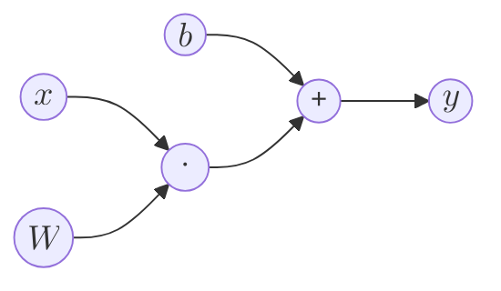
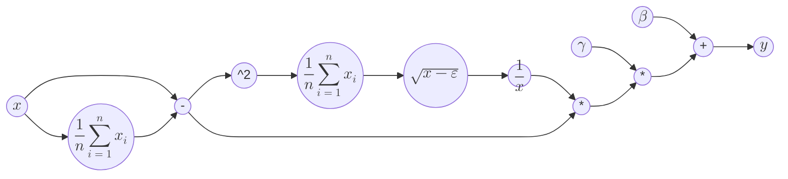
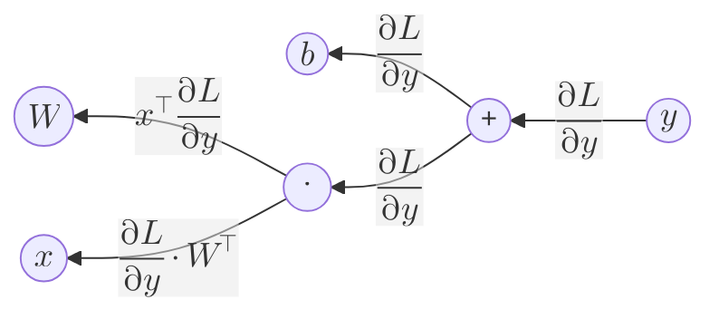
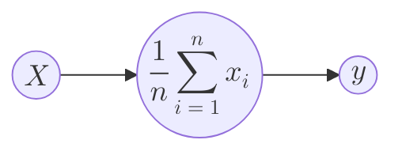

仿射层（Affine Layer）与批标准化层（Batch Normalization Layer）是神经网络中常见的两种层，其在反向传播中的梯度计算自然也是实现当中的重要环节。但对于其计算原理，大学数学的知识似乎并不能完全覆盖，因为其均涉及到实向量函数求导，这是大学数学中《线性代数》课程一般不会涉及的知识点。本文将用笔者有限的知识尽量讲解计算过程，希望能帮助读者理解。本文参考了[矩阵求导的本质与分子布局、分母布局的本质（矩阵求导——本质篇）](https://zhuanlan.zhihu.com/p/263777564)和[Understanding the backward pass through Batch Normalization Layer](https://kratzert.github.io/2016/02/12/understanding-the-gradient-flow-through-the-batch-normalization-layer.html)，在这里特别感谢。

## 正向传播的计算图

对于输入$\bm{x}=(x_1,x_2,\cdots,x_n)$，仿射层的输出$$\bm{y}=\bm{x}\cdot\bm{W}+\bm{b}$$，其中$\bm{W}_{n\times m}$为权重，$\bm{b}=(b_1,b_2,\cdots,b_m)$为偏置，用计算图可表示为

批标准化层的输出$$\bm{y}=\gamma\frac{\bm{x}-\bm{\mu}}{\sqrt{\sigma^2+\varepsilon}}+\bm{\beta}$$，其中$\bm{\mu}=(\mu,\mu,\cdots,\mu)$，$\mu=\frac{1}{n}\sum_{i=1}^{n}x_i$，$\sigma^2=\frac{1}{n}\sum_{i=1}^{n}(x_i-\mu)^2$，标量$\gamma$和向量$\bm{\beta}$为参数，标量$\varepsilon$为微小值，用计算图可表示为

## 反向传播的计算图

### 仿射层

对于仿射层，反向传播的计算图为

对于加法节点，反向传播中会将上游传来的梯度原封不动地传给下游。因为对于$f(x,y)=x+y$，有$\frac{\partial f(x,y)}{\partial x}=\frac{\partial f(x,y)}{\partial y}=1$，所以$\frac{\partial L}{\partial x}=\frac{\partial L}{\partial f(x,y)}\cdot\frac{\partial f(x,y)}{\partial x}=\frac{\partial L}{\partial f(x,y)}$，$\frac{\partial L}{\partial y}$同理。

难点在于点乘节点。对于以向量$\bm{x}=(x_1,x_2,\cdots,x_n)$为变元的实向量函数$\bm{f}(\bm{x})=(f_1(\bm{x}),f_2(\bm{x}),\cdots,f_m(\bm{x}))$，其求导结果有分子布局和分母布局两种。分子布局为$$\frac{\partial \bm{f}(\bm{x})}{\partial \bm{x}^\top}=\frac{\partial (f_1(\bm{x}),f_2(\bm{x}),\cdots,f_m(\bm{x}))}{\partial \bm{x}^\top}=\begin{pmatrix}\frac{\partial f_1(\bm{x})}{x_1}&\frac{\partial f_2(\bm{x})}{x_1}&\cdots&\frac{\partial f_m(\bm{x})}{x_1}\\\frac{\partial f_1(\bm{x})}{x_2}&\frac{\partial f_2(\bm{x})}{x_2}&\cdots&\frac{\partial f_m(\bm{x})}{x_2}\\\vdots&\vdots&\ddots&\vdots\\\frac{\partial f_1(\bm{x})}{x_n}&\frac{\partial f_2(\bm{x})}{x_n}&\cdots&\frac{\partial f_m(\bm{x})}{x_n}\end{pmatrix}$$，分母布局为$$\frac{\partial \bm{f}^\top(\bm{x})}{\partial \bm{x}}=\frac{\partial (f_1(\bm{x}),f_2(\bm{x}),\cdots,f_m(\bm{x}))^\top}{\partial \bm{x}}=\begin{pmatrix}\frac{\partial f_1(\bm{x})}{x_1}&\frac{\partial f_1(\bm{x})}{x_2}&\cdots&\frac{\partial f_1(\bm{x})}{x_n}\\\frac{\partial f_2(\bm{x})}{x_1}&\frac{\partial f_2(\bm{x})}{x_2}&\cdots&\frac{\partial f_2(\bm{x})}{x_n}\\\vdots&\vdots&\ddots&\vdots\\\frac{\partial f_m(\bm{x})}{x_1}&\frac{\partial f_m(\bm{x})}{x_2}&\cdots&\frac{\partial f_m(\bm{x})}{x_n}\end{pmatrix}$$可以看出分子布局与分母布局的求导结果互为转置。

接下来回到点乘节点。已知前向传播时输出为$m$维的行向量，输入为$\bm{x}=(x_1,x_2,\cdots,x_n)$，权重为$\bm{W}_{n\times m}$，设节点为实向量函数$$\bm{f}(\bm{x})=(f_1(\bm{x}),f_2(\bm{x}),\cdots,f_m(\bm{x}))=(\sum_{i=1}^n x_iw_{i1},\sum_{i=1}^n x_iw_{i2},\cdots,\sum_{i=1}^n x_iw_{im})$$，则分母布局的求导结果$$\frac{\partial \bm{f}^\top(\bm{x})}{\partial \bm{x}}=\begin{pmatrix}\frac{\partial f_1}{x_1}&\frac{\partial f_1}{x_2}&\cdots&\frac{\partial f_1}{x_n}\\\frac{\partial f_2}{x_1}&\frac{\partial f_2}{x_2}&\cdots&\frac{\partial f_2}{x_n}\\\vdots&\vdots&\ddots&\vdots\\\frac{\partial f_m}{x_1}&\frac{\partial f_m}{x_2}&\cdots&\frac{\partial f_m}{x_n}\end{pmatrix}=\begin{pmatrix}w_{11}&w_{21}&\cdots&w_{n1}\\w_{12}&w_{22}&\cdots&w_{n2}\\\vdots&\vdots&\ddots&\vdots\\w_{1m}&w_{2m}&\cdots&w_{nm}\end{pmatrix}=\bm{W}^\top$$，因此$$\frac{\partial L}{\partial \bm{x}}=\frac{\partial L}{\partial \bm{f}}\cdot\frac{\partial \bm{f}}{\partial \bm{x}}=\frac{\partial L}{\partial \bm{y}}\cdot\bm{W}^\top$$，即反向传播时需要右乘权重的转置。

这里使用分母布局是为了反向传播能够正常进行，因为上游传来的梯度$\frac{\partial L}{\partial \bm{y}}$为m维行向量，只能右乘权重转置，即分母布局的求导结果。

### 批标准化层

对于批标准化层，主要的难点在于求和节点，用计算图表示为

设输入为$\bm{X}_{m\times n}$，实向量函数$\bm{f}(\bm{x})=(f_1(\bm{x}),f_2(\bm{x}),\cdots,f_m(\bm{x}))=(\frac{1}{n}\sum_{i=1}^{m}x_{m1},\frac{1}{n}\sum_{i=1}^{m}x_{m2},\cdots,\frac{1}{n}\sum_{i=1}^{m}x_{mn})$。这里同样使用分母形式，即$$\frac{\partial \bm{f}^\top(\bm{x})}{\partial \bm{x}}=\begin{pmatrix}\frac{\partial f_1}{x_1}&\frac{\partial f_1}{x_2}&\cdots&\frac{\partial f_1}{x_n}\\\frac{\partial f_2}{x_1}&\frac{\partial f_2}{x_2}&\cdots&\frac{\partial f_2}{x_n}\\\vdots&\vdots&\ddots&\vdots\\\frac{\partial f_m}{x_1}&\frac{\partial f_m}{x_2}&\cdots&\frac{\partial f_m}{x_n}\end{pmatrix}=\begin{pmatrix}\frac{1}{n}&\frac{1}{n}&\cdots&\frac{1}{n}\\\frac{1}{n}&\frac{1}{n}&\cdots&\frac{1}{n}\\\vdots&\vdots&\ddots&\vdots\\\frac{1}{n}&\frac{1}{n}&\cdots&\frac{1}{n}\end{pmatrix}_{m\times n}$$，因此反向传播时需要将上游传来的梯度右乘$m\times n$维单位阵再乘$\frac{1}{n}$。