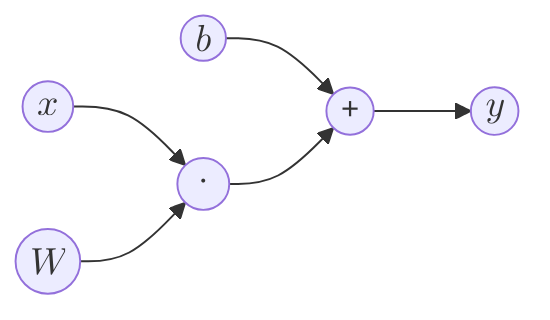
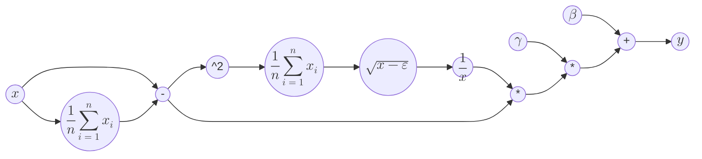
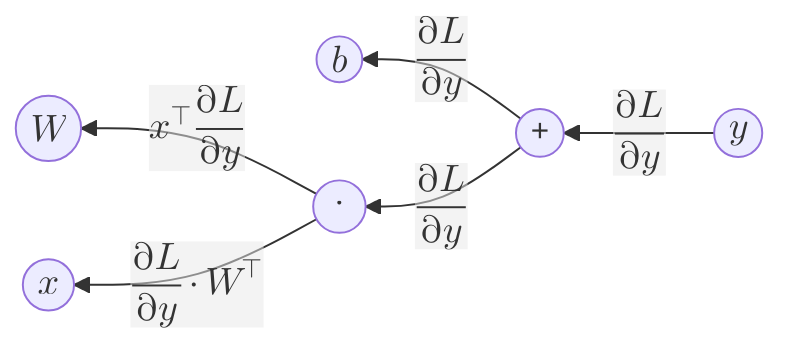
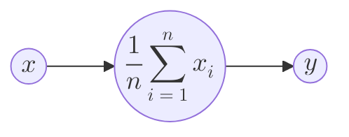

仿射层（Affine Layer）与批标准化层（Batch Normalization Layer）是神经网络中常见的两种层，但对于其反向传播中向量函数的求导，高数似乎没有过多涉及。本文将用笔者有限的知识尽量讲解求导过程，希望能帮助读者理解向量函数如何求导。本文参考了[矩阵求导的本质与分子布局、分母布局的本质（矩阵求导——本质篇）](https://zhuanlan.zhihu.com/p/263777564)和[Understanding the backward pass through Batch Normalization Layer](https://kratzert.github.io/2016/02/12/understanding-the-gradient-flow-through-the-batch-normalization-layer.html)。

## 概念

向量函数：向量函数（Vector Function）是指因变量为向量的函数，其表达式可写为分量形式，如$$\boldsymbol{f}(\boldsymbol{x})=(f_1(\boldsymbol{x}),f_2(\boldsymbol{x}),\cdots,f_n(\boldsymbol{x}))$$，其中$f_1(\boldsymbol{x}),f_2(\boldsymbol{x}),\cdots,f_n(\boldsymbol{x})$为标量函数（因变量为标量的函数），自变量可以是标量、向量或矩阵，这里$\boldsymbol{x}$是向量。

## 正向传播的计算图

对于输入$\boldsymbol{x}=(x_1,x_2,\cdots,x_n)$，仿射层的输出$$\boldsymbol{y}=\boldsymbol{x}\cdot\boldsymbol{W}+\boldsymbol{b}$$，其中$\boldsymbol{W}_{n\times m}$为权重，$\boldsymbol{b}=(b_1,b_2,\cdots,b_m)$为偏置，用计算图可表示为

批标准化层的输出$$\boldsymbol{y}=\gamma\frac{\boldsymbol{x}-\boldsymbol{\mu}}{\sqrt{\sigma^2+\varepsilon}}+\boldsymbol{\beta}$$，其中$\boldsymbol{\mu}=\mu\cdot\boldsymbol{1}$，$\mu=\frac{1}{n}\sum_{i=1}^{n}x_i$，$\sigma^2=\frac{1}{n}\sum_{i=1}^{n}(x_i-\mu)^2$，标量$\gamma$和向量$\boldsymbol{\beta}$为参数，标量$\varepsilon$为微小值，防止除0。用计算图可表示为

## 反向传播的计算图

### 仿射层

对于仿射层，反向传播的计算图为

对于加法节点，反向传播中会将上游传来的梯度原封不动地传给下游。因为对于$f(x,y)=x+y$，有$\frac{\partial f(x,y)}{\partial x}=\frac{\partial f(x,y)}{\partial y}=1$，所以$\frac{\partial L}{\partial x}=\frac{\partial L}{\partial f(x,y)}\cdot\frac{\partial f(x,y)}{\partial x}=\frac{\partial L}{\partial f(x,y)}$，$\frac{\partial L}{\partial y}$同理。

难点在于点乘节点。对于以向量$\boldsymbol{x}=(x_1,x_2,\cdots,x_n)$为自变量的向量函数$\boldsymbol{f}(\boldsymbol{x})=(f_1(\boldsymbol{x}),f_2(\boldsymbol{x}),\cdots,f_m(\boldsymbol{x}))$，其求导结果有分子布局和分母布局两种。分子布局为$$\frac{\partial \boldsymbol{f}(\boldsymbol{x})}{\partial \boldsymbol{x}^\top}=\frac{\partial (f_1(\boldsymbol{x}),f_2(\boldsymbol{x}),\cdots,f_m(\boldsymbol{x}))}{\partial \boldsymbol{x}^\top}=\begin{pmatrix}\frac{\partial f_1(\boldsymbol{x})}{x_1}&\frac{\partial f_2(\boldsymbol{x})}{x_1}&\cdots&\frac{\partial f_m(\boldsymbol{x})}{x_1}\\\frac{\partial f_1(\boldsymbol{x})}{x_2}&\frac{\partial f_2(\boldsymbol{x})}{x_2}&\cdots&\frac{\partial f_m(\boldsymbol{x})}{x_2}\\\vdots&\vdots&\ddots&\vdots\\\frac{\partial f_1(\boldsymbol{x})}{x_n}&\frac{\partial f_2(\boldsymbol{x})}{x_n}&\cdots&\frac{\partial f_m(\boldsymbol{x})}{x_n}\end{pmatrix}$$，分母布局为$$\frac{\partial \boldsymbol{f}^\top(\boldsymbol{x})}{\partial \boldsymbol{x}}=\frac{\partial (f_1(\boldsymbol{x}),f_2(\boldsymbol{x}),\cdots,f_m(\boldsymbol{x}))^\top}{\partial \boldsymbol{x}}=\begin{pmatrix}\frac{\partial f_1(\boldsymbol{x})}{x_1}&\frac{\partial f_1(\boldsymbol{x})}{x_2}&\cdots&\frac{\partial f_1(\boldsymbol{x})}{x_n}\\\frac{\partial f_2(\boldsymbol{x})}{x_1}&\frac{\partial f_2(\boldsymbol{x})}{x_2}&\cdots&\frac{\partial f_2(\boldsymbol{x})}{x_n}\\\vdots&\vdots&\ddots&\vdots\\\frac{\partial f_m(\boldsymbol{x})}{x_1}&\frac{\partial f_m(\boldsymbol{x})}{x_2}&\cdots&\frac{\partial f_m(\boldsymbol{x})}{x_n}\end{pmatrix}$$可以看出分子布局与分母布局的求导结果互为转置。

接下来回到点乘节点。已知前向传播时输出为$m$维的行向量，输入为$\boldsymbol{x}=(x_1,x_2,\cdots,x_n)$，权重为$\boldsymbol{W}_{n\times m}$，设节点为向量函数$$\boldsymbol{f}(\boldsymbol{x})=(f_1(\boldsymbol{x}),f_2(\boldsymbol{x}),\cdots,f_m(\boldsymbol{x}))=(\sum_{i=1}^n x_iw_{i1},\sum_{i=1}^n x_iw_{i2},\cdots,\sum_{i=1}^n x_iw_{im})$$，则分母布局的求导结果$$\frac{\partial \boldsymbol{f}^\top(\boldsymbol{x})}{\partial \boldsymbol{x}}=\begin{pmatrix}\frac{\partial f_1}{x_1}&\frac{\partial f_1}{x_2}&\cdots&\frac{\partial f_1}{x_n}\\\frac{\partial f_2}{x_1}&\frac{\partial f_2}{x_2}&\cdots&\frac{\partial f_2}{x_n}\\\vdots&\vdots&\ddots&\vdots\\\frac{\partial f_m}{x_1}&\frac{\partial f_m}{x_2}&\cdots&\frac{\partial f_m}{x_n}\end{pmatrix}=\begin{pmatrix}w_{11}&w_{21}&\cdots&w_{n1}\\w_{12}&w_{22}&\cdots&w_{n2}\\\vdots&\vdots&\ddots&\vdots\\w_{1m}&w_{2m}&\cdots&w_{nm}\end{pmatrix}=\boldsymbol{W}^\top$$，因此$$\frac{\partial L}{\partial \boldsymbol{x}}=\frac{\partial L}{\partial \boldsymbol{f}}\cdot\frac{\partial \boldsymbol{f}}{\partial \boldsymbol{x}}=\frac{\partial L}{\partial \boldsymbol{y}}\cdot\boldsymbol{W}^\top$$，即反向传播时需要右乘权重的转置。

这里使用分母布局是为了反向传播能够正常进行，因为上游传来的梯度$\frac{\partial L}{\partial \boldsymbol{y}}$为m维行向量，只能右乘权重转置，即分母布局的求导结果。

### 批标准化层

对于批标准化层，主要的难点在于求和节点，用计算图表示为

设标量函数$f(\boldsymbol{x})=\frac{1}{n}\sum_{i=1}^{n}x_i$。求导得$$\frac{\partial f(\boldsymbol{x})}{\partial \boldsymbol{x}}=(\frac{\partial f(\boldsymbol{x})}{\partial x_1},\frac{\partial f(\boldsymbol{x})}{\partial x_2},\cdots,\frac{\partial f(\boldsymbol{x})}{\partial x_n})=(\frac{1}{n},\frac{1}{n},\cdots,\frac{1}{n})=\frac{1}{n}\cdot\boldsymbol{1}$$，因此反向传播时需要将上游传来的梯度乘以$\frac{1}{n}\cdot\boldsymbol{1}$。

## 总结

以向量为自变量的向量函数的求导结果为矩阵，且两种求导结果互为转置；以向量为自变量的标量函数的求导结果为向量。